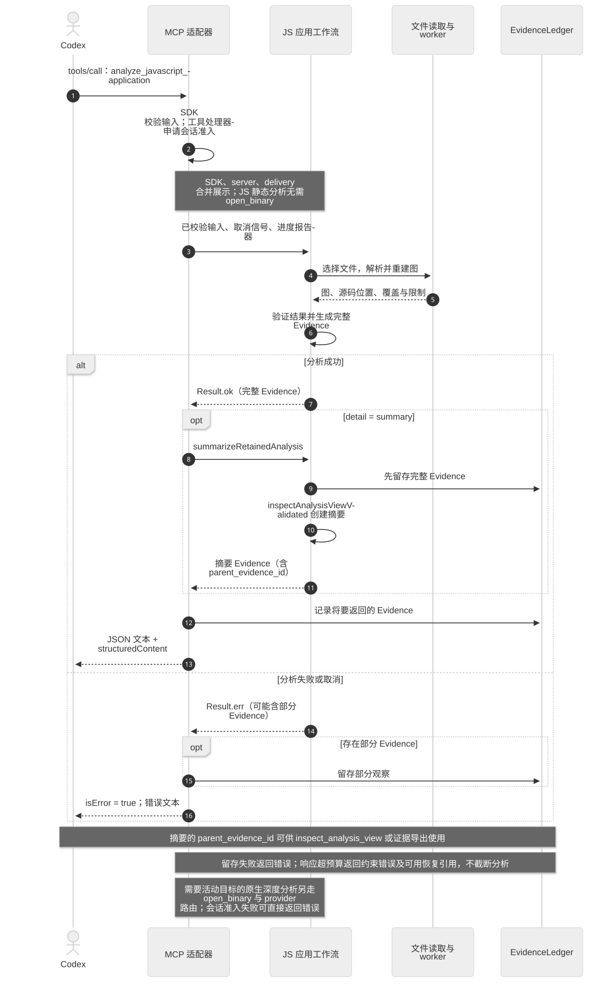

# REA 中文架构与 MCP 调用流程

REA 将本地制品分析组织为共享应用工作流，再通过 CLI 和 MCP 提供给调用方。入口负责进程生命周期，MCP 适配器负责协议与契约，应用层组织分析，格式／引擎适配器提供事实，领域层定义图、错误和 Evidence。

本文整理 2026-10-13 的 REA MCP 静态分析，并按修复后的源码基线 [`518236e7`](https://github.com/nings/rea/commit/518236e7af22b4d4563788e16ad3e11bf6a3e8fe) 核对调用链。图中箭头表示结构关系或请求流向；它们不是业务执行的动态追踪结果。

## 模块结构



[Mermaid 图源](https://github.com/nings/rea/blob/main/docs/diagrams/rea-module-structure.mmd) · [现有完整架构图](https://github.com/nings/rea/blob/518236e7af22b4d4563788e16ad3e11bf6a3e8fe/docs/architecture.mermaid)

| 模块                                     | 职责与边界                                                                                                                | 源码证据                                                                                                                                                                                                                                                                                                                                                                                                                               |
| ---------------------------------------- | ------------------------------------------------------------------------------------------------------------------------- | -------------------------------------------------------------------------------------------------------------------------------------------------------------------------------------------------------------------------------------------------------------------------------------------------------------------------------------------------------------------------------------------------------------------------------------- |
| 入口 `scripts/`、`src/main/`、`src/cli/` | `rea.mjs` 区分 MCP 与一次性 CLI；MCP 入口解析环境、创建会话并管理启动和关闭。CLI 调用共享工作流。                         | [`rea.mjs`](https://github.com/nings/rea/blob/518236e7af22b4d4563788e16ad3e11bf6a3e8fe/scripts/rea.mjs)、[`runEntrypoint`](https://github.com/nings/rea/blob/518236e7af22b4d4563788e16ad3e11bf6a3e8fe/src/main.ts)、[`transport.ts`](https://github.com/nings/rea/blob/518236e7af22b4d4563788e16ad3e11bf6a3e8fe/src/main/transport.ts)                                                                                                 |
| `composition/`                           | 连接具体 provider、会话、worker 与应用依赖；集中生产环境装配。                                                            | [`createBinarySession`](https://github.com/nings/rea/blob/518236e7af22b4d4563788e16ad3e11bf6a3e8fe/src/composition/binary.ts)、[`javascriptAnalysisWorkerProcess.ts`](https://github.com/nings/rea/blob/518236e7af22b4d4563788e16ad3e11bf6a3e8fe/src/composition/javascriptAnalysisWorkerProcess.ts)                                                                                                                                   |
| `server/`                                | `createServer` 注册工具；命名契约绑定处理函数，接入请求准入、日志、取消、进度、记录和响应编码。                           | [`createServer`](https://github.com/nings/rea/blob/518236e7af22b4d4563788e16ad3e11bf6a3e8fe/src/server/createServer.ts)、[`createContractToolHandler`](https://github.com/nings/rea/blob/518236e7af22b4d4563788e16ad3e11bf6a3e8fe/src/server/contractToolHandler.ts)、[`runAdmittedToolOperation`](https://github.com/nings/rea/blob/518236e7af22b4d4563788e16ad3e11bf6a3e8fe/src/server/admittedToolOperation.ts)                     |
| `contracts/`                             | 声明调用方可见的输入／输出 schema、名称与注解。SDK 注册直接采用这些契约，避免按目录顺序猜测操作。                         | [`toolContract`](https://github.com/nings/rea/blob/518236e7af22b4d4563788e16ad3e11bf6a3e8fe/src/contracts/toolContracts.ts)、[`toolRegistrationOptions`](https://github.com/nings/rea/blob/518236e7af22b4d4563788e16ad3e11bf6a3e8fe/src/server/toolRegistrationOptions.ts)                                                                                                                                                             |
| `application/`                           | 实现 CLI/MCP 共用的分析、重建、视图投影与调查工作流；保持事实、未知项与来源一致。                                         | [`analyzeJavaScriptApplicationValidated`](https://github.com/nings/rea/blob/518236e7af22b4d4563788e16ad3e11bf6a3e8fe/src/application/javascript/JavaScriptApplicationService.ts)、[`AnalysisViewService`](https://github.com/nings/rea/blob/518236e7af22b4d4563788e16ad3e11bf6a3e8fe/src/application/analysisView/AnalysisViewService.ts)                                                                                              |
| 格式／引擎适配器                         | `artifacts/` 读取目录和 ASAR；Hopper、Ghidra、IDA、浏览器及托管代码等适配器连接各自协议和解析器。领域模型不负责引擎协议。 | [`JavaScriptArtifactReader`](https://github.com/nings/rea/blob/518236e7af22b4d4563788e16ad3e11bf6a3e8fe/src/artifacts/javascript/JavaScriptArtifactReader.ts)、[`SessionProviderRouter`](https://github.com/nings/rea/blob/518236e7af22b4d4563788e16ad3e11bf6a3e8fe/src/application/binary/SessionProviderRouter.ts)、[`架构图`](https://github.com/nings/rea/blob/518236e7af22b4d4563788e16ad3e11bf6a3e8fe/docs/architecture.mermaid) |
| `process/`                               | 监督拥有的子进程、资源限额、超时及清理；进程所有权不能只凭 PID 或路径认定。                                               | [`process/`](https://github.com/nings/rea/blob/518236e7af22b4d4563788e16ad3e11bf6a3e8fe/src/process/)、[`所有权规则`](https://github.com/nings/rea/blob/518236e7af22b4d4563788e16ad3e11bf6a3e8fe/AGENTS.md)                                                                                                                                                                                                                            |
| `domain/`                                | 定义 Evidence、分析图、错误和纯数据语义；对规范化证据内容建立可验证身份。                                                 | [`createEvidence`](https://github.com/nings/rea/blob/518236e7af22b4d4563788e16ad3e11bf6a3e8fe/src/domain/evidence.ts)                                                                                                                                                                                                                                                                                                                  |
| 会话与调查记录                           | `BinarySession` 管理活动目标和请求生命周期；记录层拥有不可变 Evidence 与未知项。Ledger 按 ID 去重，拒绝内容冲突。         | [`BinarySession`](https://github.com/nings/rea/blob/518236e7af22b4d4563788e16ad3e11bf6a3e8fe/src/application/binary/BinarySession.ts)、[`EvidenceLedger.record`](https://github.com/nings/rea/blob/518236e7af22b4d4563788e16ad3e11bf6a3e8fe/src/application/investigation/EvidenceLedger.ts)                                                                                                                                           |

资源的解释与清理由明确的所有者负责。调用方读取其规范化事实，不在下游重复解释原始数据；清理失败时不能把仍拥有的资源当作已经释放。依赖关系与这些边界详见仓库 [架构规则](https://github.com/nings/rea/blob/518236e7af22b4d4563788e16ad3e11bf6a3e8fe/AGENTS.md#architecture-and-cleanup)。

## MCP 工具调用流程



[Mermaid 图源](https://github.com/nings/rea/blob/main/docs/diagrams/rea-mcp-tool-call-flow.mmd)

以本次实际调用的 `analyze_javascript_application` 为例：

1. **启动与注册。** Codex 启动 `rea.mjs mcp`；分发器加载 `dist/mcp/main.js`，`runEntrypoint` 创建会话，`transport.ts` 建立 stdio 服务，`createServer` 装配工具。stdio 承载 MCP 消息，运行日志写入 stderr。
2. **契约校验与准入。** [`registerElectronTools`](https://github.com/nings/rea/blob/518236e7af22b4d4563788e16ad3e11bf6a3e8fe/src/server/registerElectronTools.ts) 通过 `toolContract("analyze_javascript_application")` 和 `toolRegistrationOptions` 绑定 SDK 输入／输出 schema；输入通过适配器校验后进入处理函数。`runAdmittedToolOperation` 在提供会话准入时包住完整的执行、记录和交付流程，并传递请求取消信号。
3. **静态重建。** 处理函数调用 `analyzeJavaScriptApplicationValidated`，将文件路径、格式和 `source_paths` 等选择传给 [`reconstructJavaScriptArtifact`](https://github.com/nings/rea/blob/518236e7af22b4d4563788e16ad3e11bf6a3e8fe/src/application/javascript/JavaScriptArtifactReconstruction.ts)。它盘点制品、读取所选文本并调用源码分析，形成应用图和语义图；随后应用层验证元数据及跨图绑定，生成完整 Evidence。目录中的 JavaScript 被当作静态文本解析，不执行目标应用。
4. **摘要与记录。** 当 `detail: "summary"` 时，[`summarizeRetainedAnalysis`](https://github.com/nings/rea/blob/518236e7af22b4d4563788e16ad3e11bf6a3e8fe/src/application/analysisView/AnalysisViewService.ts) 先将完整父 Evidence 记录到会话，再调用 `inspectAnalysisViewValidated` 投影摘要。摘要是独立的 `inspect_analysis_view` Evidence，通过 `parent_evidence_id` 指向完整分析；它不是把父证据截断。外层处理函数再记录摘要并检查记录结果。
5. **响应交付。** [`ToolResultDelivery`](https://github.com/nings/rea/blob/518236e7af22b4d4563788e16ad3e11bf6a3e8fe/src/server/toolResult.ts) 在预算内返回 JSON 文本和 `structuredContent`。完整证据继续由会话保留，可用父 ID 查询视图或导出证据包；存留引用依赖该会话或显式导入的记录，不是 GitHub 上的在线资源。

这条静态 JavaScript 路径**无需先 `open_binary`，也无需 Hopper/Ghidra/IDA**。需要活动目标的原生深度分析工具通过 `BinarySession`、`SessionProviderRouter` 进入已选择的分析提供方；Go 元数据和离线布局等静态检查还有直接接收目标路径的独立入口。两类工作流共用会话准入与调查记录；工具名字位于 Electron 注册模块中，不意味着普通 JavaScript 目录依赖 Electron 运行时。

### 失败、取消与大结果

- 业务失败使用带类型的 `Result`／`AnalysisError`，返回 `isError: true`。已有部分 Evidence 时，处理函数尝试记录并以 `partial_observation` 引用保留；失败不能解释为“没有发现”。
- 请求的 `AbortSignal` 传入准入、重建和分析检查点；进度通过 MCP 上下文报告。取消与资源清理由各层所有者处理，本文不把静态源码检查当作实际取消实验。
- 超出 stdio 响应预算或 Node 单字符串限额时，返回可操作的资源约束错误，说明分析完成但交付受限，**不悄悄截断结果**。已成功记录的结果包含 Evidence 恢复引用；可导出完整证据或采用完整 CLI JSON。对支持的视图使用 `inspect_analysis_view` 分页。[`EvidenceMcpServer`](https://github.com/nings/rea/blob/518236e7af22b4d4563788e16ad3e11bf6a3e8fe/src/server/EvidenceMcpServer.ts) 的 transport 包装还处理错误交付预算；错误的内部结构化载体最终转成文本，不能把它与成功响应的 `structuredContent` 等同。

## 本次证据与覆盖范围

这次使用 REA 6.4.0 MCP，工具目录包含 186 个工具。调用记录包含一次静态分析、一次模块视图查询和一次证据包导出。

| 指标                               | 实际观测                                |
| ---------------------------------- | --------------------------------------- |
| 目录盘点的相关文件                 | 16,506                                  |
| 明确选择的文件                     | 21，包括 `package.json`                 |
| 解析的 JavaScript／TypeScript 文件 | 20                                      |
| 解析失败                           | 0                                       |
| 读取文本字节                       | 201,927                                 |
| 未纳入源码分析的文件               | 16,485                                  |
| 图覆盖                             | `partial`；未选源码关系及动态行为仍未知 |

摘要视图的 `complete-within-view` 只表示该视图投影范围完整，不能扩大为整个项目分析完整。模块职责和上面的调用顺序结合了 MCP 静态观测与源码阅读；未进行业务逻辑动态追踪，也未验证真实原生 provider。静态导入、调用候选或相同函数指纹不证明运行时执行或行为等价。

可追溯身份如下；它们记录原始分析现场，后续重跑不要求产生相同 ID：

```text
完整父 Evidence：
ev_6ca14db1adcc1f3df1a3be9f8995f5ff8ca78013e2dc8cb5bb927329467ec6b2
摘要 Evidence（operation = inspect_analysis_view）：
ev_d93d113734e1c5e8b3a6423ddff99d6ef27fa80248d24dec2497aaa3a1cb6073
模块分页 Evidence：
ev_c763ac87c355ca1b764da9bbe0f41c1dd56102721c4cc043c2a033320fb19a32
原始目录制品 SHA-256：
f81df2b39e0bdc26d37ccbddfb84c94cbb0a86201a09e0fd53c82b8fe83d32f2
```

目录制品身份覆盖盘点范围，可能受依赖、构建输出或新增文档影响；它不是 Git 提交 SHA。Evidence 身份还受输入路径、参数、结果及来源内容影响。约 267 MB 的完整证据包作为本地分析记录保存，未加入仓库；以上 ID 与源码链接用于说明来源，不能代替完整证据包。

## 复现同一分析选择

连接 REA MCP 后，将 `input_path` 替换为本机 REA 仓库的绝对路径，调用：

```json
{
  "name": "analyze_javascript_application",
  "arguments": {
    "input_path": "/absolute/path/to/rea",
    "format": "directory",
    "source_paths": [
      "package.json",
      "scripts/rea.mjs",
      "src/main.ts",
      "src/main/transport.ts",
      "src/server/createServer.ts",
      "src/server/EvidenceMcpServer.ts",
      "src/server/registerElectronTools.ts",
      "src/server/contractToolHandler.ts",
      "src/server/admittedToolOperation.ts",
      "src/server/toolResult.ts",
      "src/contracts/toolContracts.ts",
      "src/application/javascript/JavaScriptApplicationService.ts",
      "src/application/javascript/JavaScriptArtifactGraphBuilder.ts",
      "src/application/analysisView/AnalysisViewService.ts",
      "src/application/binary/BinarySession.ts",
      "src/application/binary/SessionProviderRouter.ts",
      "src/application/investigation/EvidenceLedger.ts",
      "src/composition/binary.ts",
      "src/artifacts/javascript/JavaScriptSourceAnalysis.ts",
      "src/composition/javascriptAnalysisWorkerProcess.ts",
      "src/domain/evidence.ts"
    ],
    "detail": "summary"
  }
}
```

取返回摘要中的**新** `parent_evidence_id`，在同一会话查询模块分页：

```json
{
  "name": "inspect_analysis_view",
  "arguments": {
    "source": {
      "kind": "retained-evidence",
      "evidence_id": "<parent_evidence_id>"
    },
    "view": {
      "kind": "page",
      "collection": "modules",
      "offset": 0,
      "limit": 64
    }
  }
}
```

如返回 `coverage.next_offset`，按该值继续分页。理解公共契约、输出覆盖与测试边界可进一步阅读 [MCP contracts](./mcp-contracts.md)、[工具设计](./tool-design.md) 和 [测试说明](./testing.md)。
